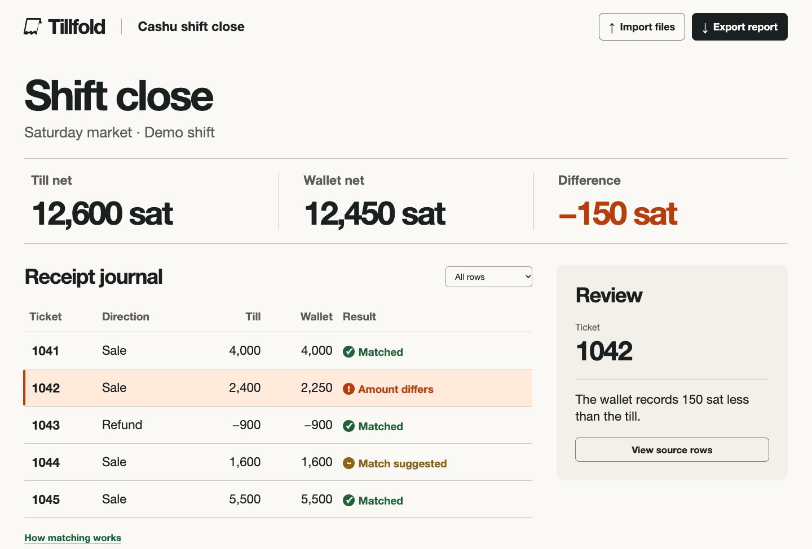

# Tillfold

Tillfold helps a merchant close a shift paid in Cashu. It compares the till’s receipt CSV with a Cashu wallet’s NIP-60 spending history and lets the cashier review the differences. Files stay in the browser. Signers are only asked to decrypt eligible history events.

**Try the Saturday market shift.** Open the [live demo](https://murraykp.github.io/tillfold-cashu/), select ticket 1042 and inspect its source rows. The till recorded 2,400 sat, while the wallet recorded 2,250 sat against the same event ID. Select 1044 to review a time-and-amount match. Confirm it, then export the full report.



## Your own shift

1. Export your till receipts for one shift as CSV. Use the columns in the [example](examples/till.csv). The required fields are `ticket`, `time`, `direction`, `amount` and `unit`. The optional `event_id` is the Nostr ID of the wallet’s **spending history** event. Each ticket and each supplied event reference must be unique.
2. Export the same shift’s `kind:7376` events as a JSON array or newline-delimited JSON. Use one wallet per import. The [example history](examples/wallet-history.json) contains fictional, already-decrypted records. A decrypted record retains the original history event’s `id` and `created_at` and places the decrypted tag array in `content`.
3. Choose **Import files**. For signed, encrypted events, the app checks each event’s Nostr ID and signature, checks the author against your selected NIP-07 signer, then requests NIP-44 decryption through the extension. A plaintext export is treated as supplied evidence. The wallet’s private key, seed, bearer tokens and proof events are unnecessary.
4. Review discrepancies and suggested pairs. Use the unit selector when your shift contains more than one currency. **Export report** includes all units and all rows, even when a screen filter is active. Closing the page clears the session.

Amounts are positive integers in each protocol unit’s smallest denomination. Direction is `in` for a sale or `out` for a refund. Till timestamps use ISO 8601 with a timezone. Nostr events use Unix seconds. Each file can contain up to 5,000 rows and occupy up to 5 MiB. Split larger exports by shift.

If you use the `nak` Nostr CLI, this read-only example retrieves encrypted history from a relay you already use. Replace the example values with your own public key, shift timestamps and relay. The request publishes nothing. A wallet may sync to more than one relay.

```sh
nak req -k 7376 -a "$MY_PUBLIC_HEX" --since "$SHIFT_START_UNIX" --until "$SHIFT_END_UNIX" "$MY_RELAY" > wallet-history.ndjson
```

## How the journal is reconciled

- A referenced event matches automatically when its amount, direction and unit agree. A conflicting amount, direction or unit stays visible. Missing event IDs stay missing even when another event looks similar.
- With no reference, Tillfold considers events within five minutes on either side for the same direction, unit and amount. A unique candidate on both sides can be confirmed manually. Overlapping candidates stay ambiguous. The journal shows up to five candidate IDs and the full candidate count.
- Identical copies of a history event from different relays count once. Conflicting copies stop the import. Events shared by ambiguous tickets remain visible as wallet-only until resolved by an explicit reference.
- Totals use integer arithmetic. Wallet net minus till net is calculated for each currency independently. NIP-60 spending history is optional and its standard history record does not identify a mint. The report measures agreement between the supplied records. It cannot establish a redeemable balance, assign movements to individual mints or distinguish a missing wallet record from an unpaid sale.
- The browser reads local files into memory. Tillfold makes no relay or mint requests, uses no analytics and persists no wallet data. A CSV report contains transaction history and should be stored accordingly.

## Run locally

The app is a static site with its verifier already bundled. From this folder run `python3 -m http.server 8080 --bind 127.0.0.1`, then open `http://127.0.0.1:8080`. Serving the files locally also supports offline use.

```sh
npm test
```

The tests run with Node’s built-in runner and no install step. They cover file parsing, matching in either direction, mixed units, exact large integer totals, repeated relay events, signature verification, conflicting records, encrypted-history handling and a high-density ambiguous shift. The signer test uses a real signed Nostr fixture and a simulated browser signer. Device and wallet support for NIP-44 depends on the user’s extension.

To reproduce the bundled signature verifier run `npm ci` and `npm run vendor`. It comes from `nostr-tools`, `@noble/curves` and `@noble/hashes`. Their notices are in `vendor/`. Original app code is MIT licensed. The product, demo and tests were built in November 2026 by Kit Rx Studio with AI assistance.

## References

- [NIP-60 Cashu wallet and spending history events](https://github.com/nostr-protocol/nips/blob/master/60.md)
- [NIP-07 browser signer interface](https://github.com/nostr-protocol/nips/blob/master/07.md)
- [NIP-44 encryption](https://github.com/nostr-protocol/nips/blob/master/44.md)
- [nak command-line client](https://github.com/fiatjaf/nak)
